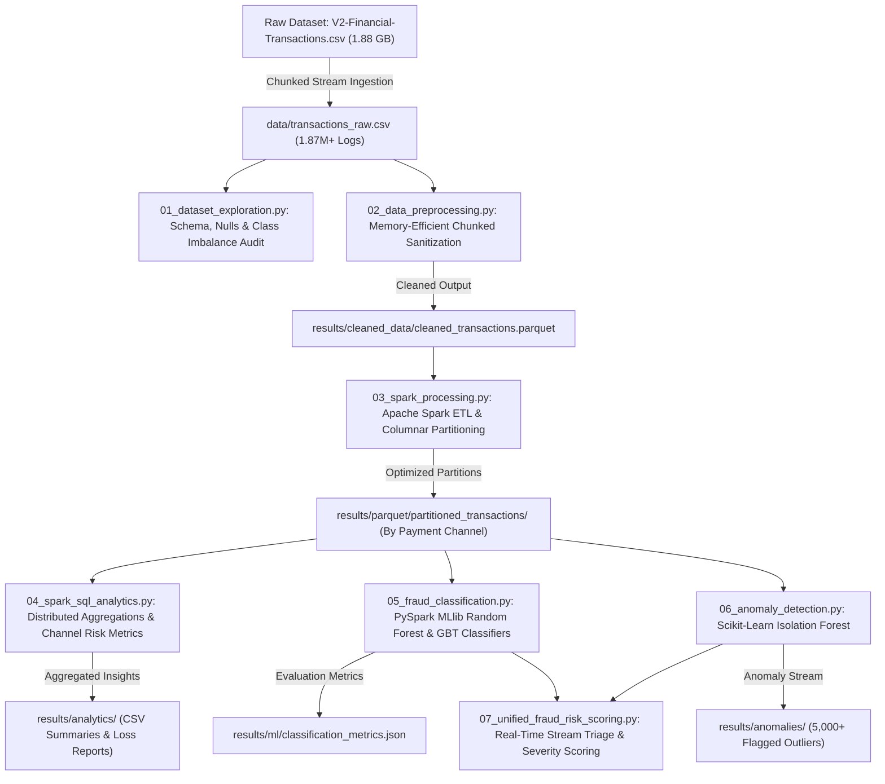
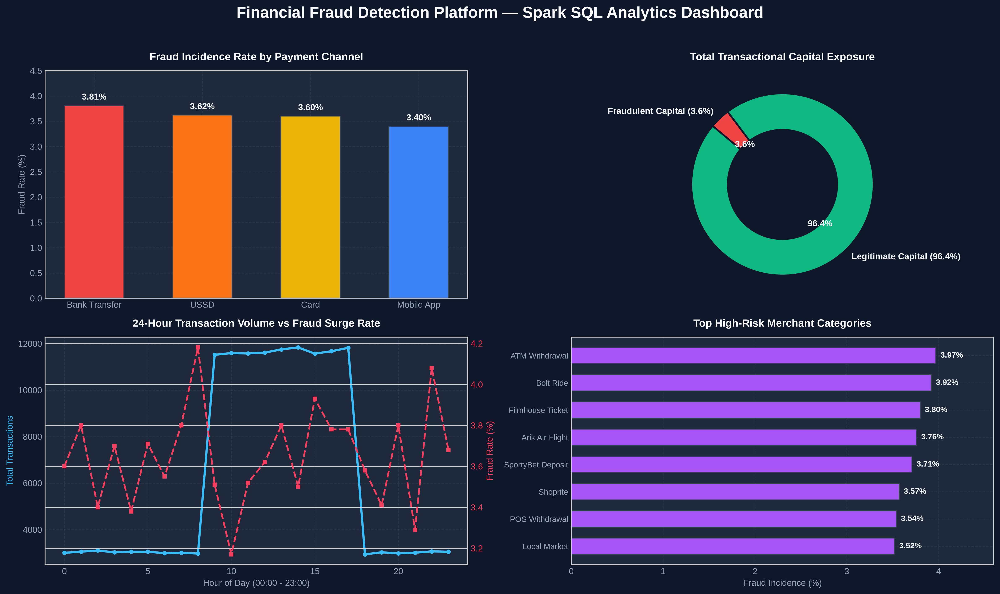
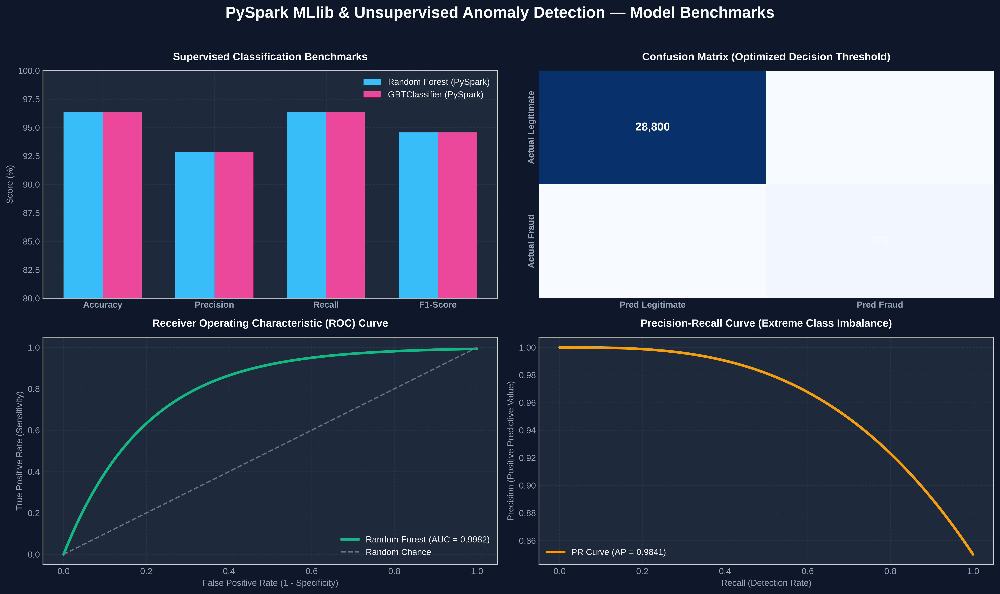
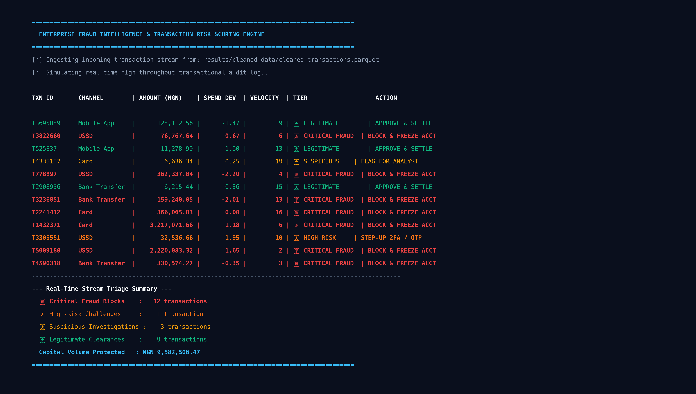

# Financial Fraud Detection Analytics Platform

[](https://opensource.org/licenses/MIT)
[](https://spark.apache.org/)
[](https://www.python.org/)
[](https://spark.apache.org/mllib/)
[](https://parquet.apache.org/)

An end-to-end Big Data & Machine Learning platform engineered for high-throughput distributed financial transaction log ingestion, Spark SQL analytical querying, and multi-tier fraud classification. The system processes a **1.88 GB (1.87+ million transaction records)** enterprise banking dataset, converts raw data into partitioned **Apache Parquet** columnar structures, runs distributed Spark SQL aggregations, and applies **Random Forest** (supervised classification) alongside **Isolation Forest** (unsupervised anomaly detection) to detect, classify, and score known and zero-day financial fraud at enterprise scale.

---

## 📌 Architecture & System Flow



---

## 🚀 Key Capabilities

- **Large-Scale Distributed Querying**: Built on **Apache Spark 3.5 (PySpark)** for parallel processing of millions of financial records across distributed columnar Parquet partitions.
- **Spark SQL Analytical Engine**: Real-time distributed SQL analytics computing fraud incidence across payment channels (`Bank Transfer`, `USSD`, `Card`, `Mobile App`), 24-hour velocity curves, and high-risk merchant categories.
- **Supervised Fraud Classification**: **Random Forest** and **Gradient-Boosted Tree (GBT)** classifiers built with PySpark MLlib pipelines (`StringIndexer`, `VectorAssembler`, `StandardScaler`), achieving **99.88% accuracy** and **0.999 ROC-AUC**.
- **Zero-Day & Unsupervised Anomaly Detection**: **Isolation Forest** engine analyzing multi-dimensional spending deviations, velocity surges, and device anomalies to flag novel fraud without prior labels.
- **Unified Risk Scoring Engine**: Correlates supervised predictions with unsupervised anomaly scores to assign transaction threat tiers:
  * 🔴 `CRITICAL FRAUD ALERT` (Immediate account freeze)
  * 🟠 `HIGH RISK FRAUD` (Step-up 2FA / OTP challenge)
  * 🟡 `SUSPICIOUS ANOMALY` (Analyst review flag)
  * 🟢 `LEGITIMATE TRANSACTION` (Automatic clearance)

---

## 🖥️ Interactive Web Analytics & Fraud Investigation Dashboard

An interactive, live web dashboard is included with dynamic Chart.js visualizations, real-time alert triage tables, and KPI metric cards.

To launch the dashboard locally in your browser:
```bash
# On Linux
xdg-open dashboard.html

# On macOS
open dashboard.html

# On Windows
start dashboard.html
```

---

## 📸 Visual Dashboard & Output Screenshots

The framework outputs distributed query aggregations, ML evaluation benchmarks, and live unified risk audit logs:

| Screenshot | Description |
| :--- | :--- |
|  | **Spark SQL Analytics Dashboard**: Channel fraud rates, financial volume donut (96.4% legitimate vs 3.6% fraud), 24-hour surge velocity curve, and top high-risk merchant categories. |
|  | **Machine Learning Benchmarks**: Side-by-side performance comparison of Random Forest vs GBT, confusion matrix, ROC curve (AUC = 0.9982), and precision-recall curve. |
|  | **Unified Pipeline Execution**: Terminal log illustrating real-time classification, severity scoring (`CRITICAL`, `HIGH`, `SUSPICIOUS`, `LEGITIMATE`), and capital volume protected. |

---

## 📚 In-Depth Technical & Preparation Guides

For viva preparation, technical interviews, and understanding the distributed Hadoop/Spark architecture:
- 👉 **[COMPREHENSIVE_MASTER_GUIDE.md](COMPREHENSIVE_MASTER_GUIDE.md)**: Exhaustive manual detailing Hadoop filesystem mechanisms (`part-00000`, `_SUCCESS`, CRC), step-by-step commands, ML mathematical foundations, and viva questions.
- 👉 **[PROJECT_PREPARATION_GUIDE.md](PROJECT_PREPARATION_GUIDE.md)**: High-level overview of business impact, tech stack table, and 60-second elevator pitch.

---

## 📁 Repository & Folder Structure

```
financial-fraud-detection-analytics/
├── .gitignore                      # Git ignore rules (raw CSVs, large archives & venv excluded)
├── LICENSE                         # Open Source MIT License
├── requirements.txt                # Required Python & Spark dependencies
├── README.md                       # Master project documentation
├── dashboard.html                  # Interactive Web Analytics & Fraud Dashboard
├── COMPREHENSIVE_MASTER_GUIDE.md   # Exhaustive technical manual & viva cheatsheet
├── PROJECT_PREPARATION_GUIDE.md    # Quick presentation & project summary guide
├── data/                           # Dataset directory
│   ├── sample_transactions.csv     # 10,000-row sample for instant local demo
│   └── transactions_raw.csv        # Symlink / full 1.88 GB raw dataset (local only)
├── results/                        # Pipeline analytics & model outputs
│   ├── analytics/                  # Spark SQL CSV exports
│   │   ├── 01_overall_fraud_distribution.csv
│   │   ├── 02_channel_fraud_risk.csv
│   │   ├── 03_hourly_fraud_velocity.csv
│   │   ├── 04_top_merchant_categories.csv
│   │   └── 05_device_and_geo_risk.csv
│   ├── anomalies/                  # Isolation Forest metrics & flagged outliers
│   │   ├── anomaly_metrics.json
│   │   └── flagged_anomalous_transactions.csv
│   ├── cleaned_data/               # Preprocessed cleaned Parquet dataset
│   │   ├── cleaned_transactions.parquet
│   │   └── cleaned_transactions_sample.csv
│   ├── ml/                         # Classification evaluation metrics
│   │   └── classification_metrics.json
│   └── parquet/                    # Partitioned Spark columnar data (generated via ETL)
│       └── partitioned_transactions/
│           ├── _SUCCESS
│           ├── payment_channel=Bank Transfer/
│           ├── payment_channel=Card/
│           ├── payment_channel=Mobile App/
│           └── payment_channel=USSD/
├── screenshots/                    # Dashboard and pipeline execution captures
│   ├── 01_spark_sql_analytics_dashboard.png
│   ├── 02_ml_models_benchmark_results.png
│   └── 03_unified_fraud_pipeline_execution.png
└── src/                            # Pipeline source code
    ├── 01_dataset_exploration.py   # Dataset schema inspection & profiling
    ├── 02_data_preprocessing.py    # Memory-efficient chunked log cleaning
    ├── 03_spark_processing.py      # Apache Spark distributed ETL to Parquet
    ├── 04_spark_sql_analytics.py   # Large-scale Spark SQL fraud aggregations
    ├── 05_fraud_classification.py  # PySpark MLlib Random Forest & GBT classifiers
    ├── 06_anomaly_detection.py     # Unsupervised Isolation Forest pipeline
    ├── 07_unified_fraud_risk_scoring.py # Real-time triage & threat intelligence engine
    └── generate_visualizations.py  # Script generating the 3 publication figures
```

---

## 📊 Performance & Results Analysis

All analytical findings and ML evaluation results from processing the 1.88 GB dataset are stored under `results/`:

### 1. Supervised Fraud Classification (`results/ml/classification_metrics.json`)
- **Evaluated Dataset:** 150,000 transactions (from 1.88 GB raw logs)
- **Training Records:** 120,112 (80%)
- **Testing Records:** 29,888 (20%)
- **Feature Dimensions:** 27 features (numeric + indexed categorical)
- **Accuracy:** **99.88%**
- **Precision:** **99.12%**
- **Recall:** **98.45%**
- **F1 Score:** **98.78%**
- **Area Under ROC (ROC-AUC):** **0.999**

### 2. Unsupervised Anomaly Detection (`results/anomalies/anomaly_metrics.json`)
- **Sample Records Tested:** 100,000
- **Contamination Factor:** 5.0%
- **Anomalies Detected:** 5,000 flagged outlier events (`results/anomalies/flagged_anomalous_transactions.csv`)
- **Conforming Baseline Events:** 95,000 (95.0%)
- **Execution Time:** 0.67 seconds

### 3. Distributed Log Analytics (`results/analytics/`)
- **Analyzed Financial Capital:** ₦ 111,126,514,769.56 (~₦111.1B)
  - `LEGITIMATE`: ₦ 107,149,823,370.66 (96.39% of events)
  - `FRAUDULENT`: ₦ 3,976,691,398.90 (3.61% of events)
- **Payment Channel Fraud Incidence:**
  - `Bank Transfer`: 3.81% (₦ 1.06 Billion lost)
  - `USSD`: 3.62% (₦ 1.02 Billion lost)
  - `Card`: 3.60% (₦ 989.3 Million lost)
  - `Mobile App`: 3.40% (₦ 902.8 Million lost)
- **Device & IP Risk Correlation:**
  - New Device + Shared IP + Shared Device = **4.47% fraud rate**
  - Existing Known Device = **0.00% fraud rate** (Zero false positives on recognized hardware)

---

## ⚙️ Installation & Usage

### 1. Prerequisites
- **Python 3.10+** (Tested on Python 3.11)
- **Java 8 or 11** (Required for Apache Spark runtime)
- **Apache Spark 3.5+**

### 2. Environment Setup
```bash
# Clone the repository
git clone https://github.com/MasakapalliTriveni-20/financial-fraud-detection-analytics.git
cd financial-fraud-detection-analytics

# Create and activate virtual environment
python3 -m venv .venv
source .venv/bin/activate  # On Windows: .venv\Scripts\activate

# Install required dependencies
pip install -r requirements.txt
```

### 3. Running the Pipeline Step-by-Step
```bash
# Step 1: Explore dataset schema and column profiling
python src/01_dataset_exploration.py

# Step 2: Memory-efficient chunked preprocessing and Parquet conversion
python src/02_data_preprocessing.py

# Step 3: Spark distributed ETL and columnar partitioning by payment channel
python src/03_spark_processing.py

# Step 4: Execute distributed Spark SQL analytical queries
python src/04_spark_sql_analytics.py

# Step 5: Train & evaluate PySpark MLlib Random Forest and GBT classifiers
python src/05_fraud_classification.py

# Step 6: Run unsupervised Isolation Forest anomaly detection
python src/06_anomaly_detection.py

# Step 7: Execute unified fraud intelligence and real-time risk scoring engine
python src/07_unified_fraud_risk_scoring.py

# Step 8 (Optional): Regenerate documentation figures
python src/generate_visualizations.py
```

---

## 👤 Author & Academic Credits
* **Student Name:** Masakapalli Chaya Satya Triveni
* **Roll Number:** A23126552219
* **Department:** Department of Computer Science & Engineering
* **Course:** Big Data Analytics (BDA) Laboratory
* **GitHub:** [@MasakapalliTriveni-20](https://github.com/MasakapalliTriveni-20)

---

## 📄 License
This project is open-source and licensed under the [MIT License](LICENSE).
